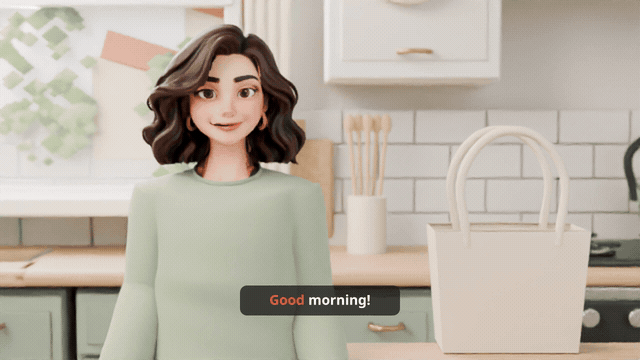
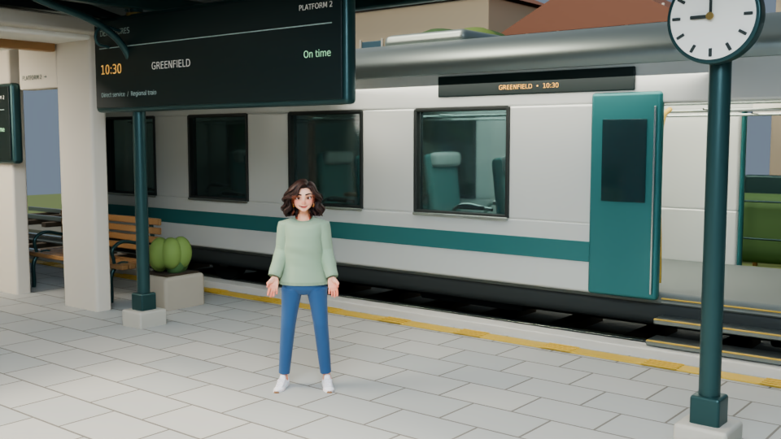

# Lily v2 — CPU look-development prototype

This is the revised **character, environment and short-motion prototype**, not
the completed 55-second film. It replaces the previous Ellie-based design with
an adult character, a new sage sweater/jeans outfit, custom facial controls,
and a station/train environment. Development and preview rendering used the
CPU; a GPU has not been connected or used for this prototype.

Silent preview above. [Play/download the MP4 with narration](previews/Lily_V2_CPU_First_Line_Test.mp4).

The 12-line, 55-second story plan is in [storyboard.json](storyboard.json).
Visual acceptance targets are in [reference_analysis.md](reference_analysis.md).
The new character is an adaptation of a different source model, so its identity
and surface detail do not exactly reproduce the reference video.

## Files to review

| File | Actual contents |
| --- | --- |
| [Lily_V2_CPU_Lookdev.blend](Lily_V2_CPU_Lookdev.blend) | Packed Blender project with four look-development scenes, the adult character, home/travel props, station/platform/train and new wardrobe/facial controls |
| [previews/home_hero.png](previews/home_hero.png) | CPU-rendered, CPU-denoised home character/material/camera study |
| [previews/station_wide.png](previews/station_wide.png) | CPU-rendered station/platform composition showing Lily and a regional train |
| [previews/train_interior.png](previews/train_interior.png) | Environment study of passenger seats, windows, tables and interior details; Lily is not staged in this interior preview |
| [previews/station_exterior.png](previews/station_exterior.png) | CPU station facade and approach environment study |
| [Lily_V2_CPU_Motion_Test.blend](Lily_V2_CPU_Motion_Test.blend) | Home scene only, with a 108-frame/4.5-second native-24-fps facial/head-motion test |

The motion test maps Rhubarb speech mouth cues to custom jaw/round controls,
adds a blink and a small head movement, and uses native animation frames rather
than optical-flow frame interpolation. The playable [first-line test](previews/Lily_V2_CPU_First_Line_Test.mp4) is 4.5 seconds, with the complete first sentence and highlighted captions. It is not a 55-second animation.

## Open the packed projects

Download the `.blend` files from GitHub and open them in **Blender 4.3 or newer**.
They use native Blender meshes, materials, armatures, shape keys and simple
drivers. **No add-on, MCP connection or video plugin is required to open them.**
The build scripts are not required for viewing or editing the packed projects.

In the look-development file, choose a scene from Blender's top-bar Scene menu:

1. `01 Home — Reference Lookdev`
2. `02 Station — Reference Lookdev`
3. `03 Train Interior — Environment Lookdev`
4. `04 Station Exterior — Environment Lookdev`

Press **Numpad 0** for the active camera view. The station scene also has a
`Station narrative wide` camera. To use it, select that camera and choose
**View > Cameras > Set Active Object as Camera**. The supplied wide PNG was
rendered with Lily turned approximately 39 degrees around her root Z axis.
The exterior scene is also shown in [the station exterior study](previews/station_exterior.png).

The character collection is shared between the home and station scenes.
Changing Lily's root pose, rotation or facial controls affects both scenes.
The look-development timeline has a 1–1320 range at 24 fps as a duration
placeholder; it does not contain a completed 55-second story performance.

## Character controls

Select **`Lily_Actor`** in the Outliner, then open **Object Properties > Custom
Properties**. Its facial controls have a 0–1 range:

| Property | Purpose | Useful preview value |
| --- | --- | --- |
| `jaw_open` | Opens the custom mouth/lower oral geometry | 0.15–0.35 for a modest speaking pose |
| `mouth_round` | Narrows/rounds the lips | 0.3–0.7 with a small jaw opening |
| `smile` | Raises and widens the mouth corners | 0.10 is the saved mild smile |
| `blink` | Closes fitted upper/lower eyelids | 0 open; 1 closed |

The body armature is **`Lily_Body_Rig`**. Select it and enter Pose Mode for body
bones. The base has a deform/body rig; the added mouth recess, teeth, tongue
and eyelids follow the head through native armature modifiers.

Use the static look-development file to try facial values. The motion-test
file has keyed controls, so changing the timeline can overwrite a manual
value. Its playback range is frames **1–108 at 24 fps**, with narration packed and the audio strip trimmed to the first sentence. The complete revised 55-second story edit is unfinished.

## Rendering a new CPU still

Choose the scene/camera, select **Cycles** and **CPU** in Render Properties,
choose an output path, and use **Render > Render Image**. The saved lookdev
settings use 960×540 CPU previews and multilayer EXR output. The short motion
test uses 640×360, 8-sample CPU renders before presentation export.

The published PNG studies were denoised locally with Intel Open Image Denoise
and displayed through AgX with Medium High Contrast. A raw saved-project
render will look noisier unless denoising is also applied. On a Blender build
with CPU Open Image Denoise support, enable Render Denoise for a convenient
local preview. Portable geometry/build sources and the base asset are included in `source/`. See [source instructions](source/README.md) for the rebuild sequence. The local denoiser binaries and Python environment are not bundled.

## What remains for the final 55 seconds

- Review the adult face, hair, sweater fit/materials, lighting and camera
  against the reference. Hair-color transitions/source texture artifacts,
  cloth drape and close facial deformation still need final polish.
- Build the full performance and edit across the planned home, Anna/Greenfield
  inserts, departure display, platform, boarding and train-interior shots.
- Finish and test real phone/wallet/bottle/bag grips, bag-content continuity,
  walking/boarding foot contact, eye direction and restrained adult acting.
  The station preview is a staging study and does not yet show the packed bag.
- Expand/refine the limited jaw/round/smile/blink system for the full dialogue;
  Rhubarb timing is a starting point, not a guarantee of precise lip sync.
- Assemble the full narration and highlighted captions, render approved native
  frames, and check the final 55-second movie. A full V2 movie has not been
  rendered or published by this prototype handoff.

## Sources and licenses

- **Base character:** [Grab3D Casual Woman](https://grab3d.com/models/characters/woman/),
  **CC0 1.0**. Retain the supplied `LICENSES/Grab3D_CC0.txt` and source notes.
  Its source explicitly discloses an **AI-assisted base mesh and textures**
  generated with Meshy and cleaned/checked in Blender. The custom facial
  geometry, clothing and reference-oriented material changes are adaptations.
  The V2 character is not the earlier Ellie/CC-BY character.
- **Home, railway set and new wardrobe:** project-authored Blender geometry
  and materials. The railway includes platform depth, departure signage,
  train doors/steps/vestibule and passenger seating.
- **Speech mouth-cue analysis:** [Rhubarb Lip Sync](https://github.com/DanielSWolf/rhubarb-lip-sync),
  MIT. Its analysis output does not require the Rhubarb application to open
  or animate the packed Blender file.
- **Denoising:** [Intel Open Image Denoise](https://github.com/RenderKit/oidn),
  Apache-2.0; used locally on the CPU. Do not omit its notices if distributing
  its binaries. The packed scene and review PNGs do not require that binary.
- **Fonts:** station text uses DejaVu Sans (Bitstream Vera/DejaVu notices);
  caption exports use Noto Sans Bold (SIL Open Font License 1.1). Keep the
  applicable copyright/license files when publishing packed or separate fonts.
- **Local production control:** [Blender MCP](https://github.com/ahujasid/blender-mcp),
  MIT, was used during development. It is not required by these packed files.

The user's reference footage guided the presentation. It is not included in
the V2 preview renders or a redistributed source-character rig.

## Included production media

The `audio/` folder contains the complete 55-second narration. `captions/` contains the timed highlighted ASS captions and its licensed Noto font. These reusable media do not imply that the revised full-length film has been rendered.

[Download the complete CPU preview/source ZIP](Lily_V2_CPU_Preview_Pack.zip), unzip it, and open **Gallery.html** for the video and scene previews. The website source is also uploaded; [GitHub Pages activation](WEBSITE_SETUP.md) requires the repository owner because the connected app received HTTP403 for the Pages API.

## Moving to Codex Local

Read [the continuation handoff](LOCAL_CODEX_HANDOFF.md). The complete ZIP also contains that handoff and low-load agent instructions. Unzip and open **Gallery.html** to review the video and scene images without launching Blender.
